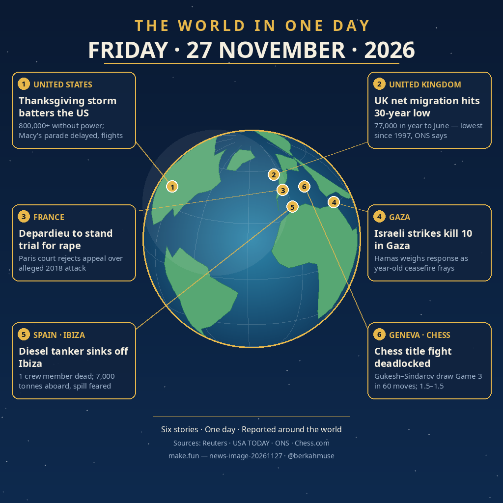

# The World in One Day — 27 November 2026

[](https://make.fun/c/news-image-20261127)

Entry for the make.fun competition
[Sum up 27 November's world news in one image](https://make.fun/c/news-image-20261127)
(`news-image-20261127`).

A globe-centred world infographic: one drawn globe with the day's six
verified stories as numbered callouts around it, each pinned to where it
happened.



## The six stories

1. **United States** — Thanksgiving storm batters the US: 800,000+ without
   power; Macy's parade delayed, flights grounded.
2. **United Kingdom** — UK net migration hits a 30-year low: 77,000 in the
   year to June, the lowest since 1997 (ONS).
3. **France** — Gérard Depardieu to stand trial for rape: Paris court rejects
   his appeal over the alleged 2018 attack.
4. **Gaza** — Israeli strikes kill 10 in Gaza; Hamas weighs its response as
   the year-old ceasefire frays.
5. **Spain · Ibiza** — Diesel tanker *Med Emre* sinks off Ibiza: 1 crew
   member dead, 7,000 tonnes aboard, spill feared.
6. **Geneva · Chess** — Chess title fight deadlocked: Gukesh–Sindarov draw
   Game 3 in 60 moves; 1.5–1.5.

Sources: Reuters, USA TODAY, ONS, Chess.com. All six stories were first
reported on 27 November 2026 (in at least one time zone).

## Run

```sh
python3 draw.py   # redraws entry.png (Pillow, build time only)
mkdir -p out && MAKEFUN_OUTPUT_DIR=out python3 main.py  # writes out/entry.png
```

`main.py` (Python 3.13, standard library only) copies `entry.png` to
`/output/entry.png` after checking it is a whole PNG of at most 1024×1024
pixels and at most 1 MiB. Two runs produce byte-identical output
(sha256 `c09c45443354bdadd5e040461a2bd540effff7f629e94c31346f5e9db97d4c04`).

Anchor: drand round 34311782 (`d0561e1798e46771454281d5950581c9cdd7385b`).

## License

MIT — see `LICENSE`.
